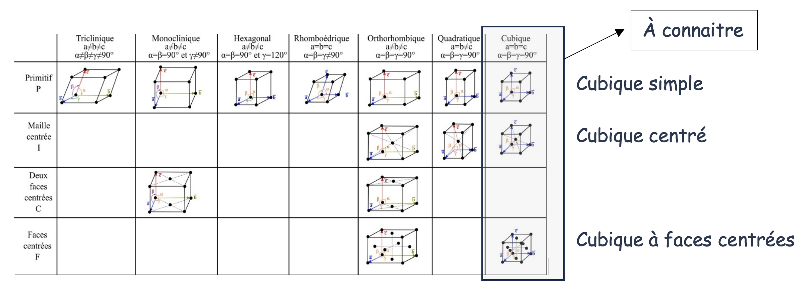
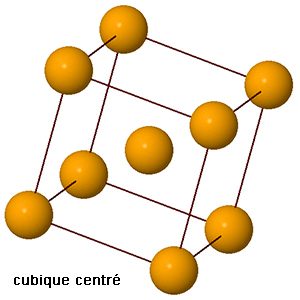
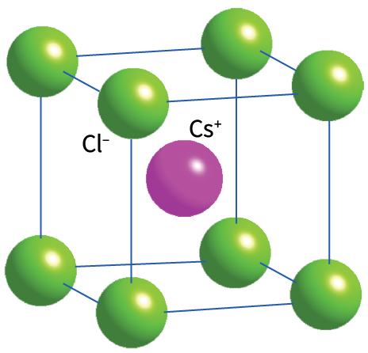
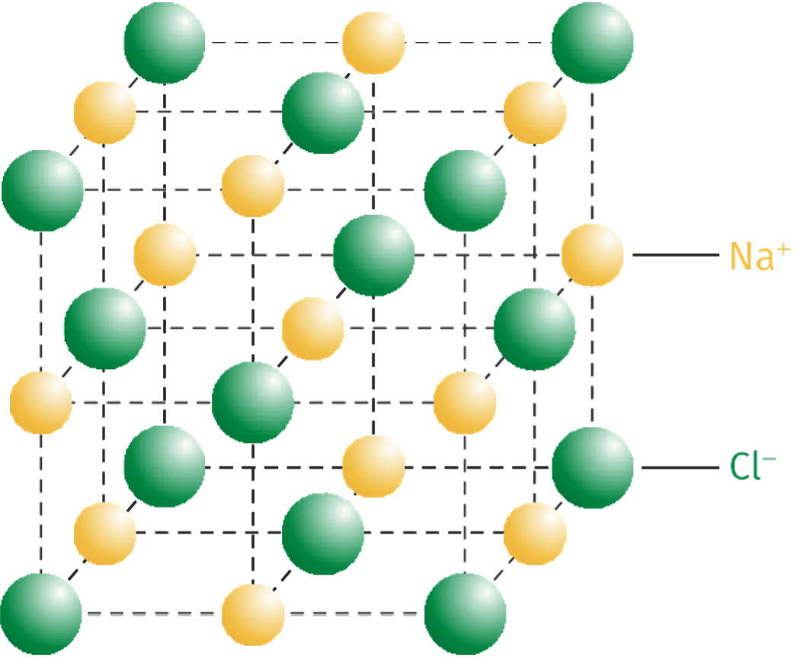

# Chapitre 4 : Les cristaux

{{ initexo(0) }}

Les cristaux, des édifices ordonnées

## 1. Les structures cristallines des solides 

### A. Des solides cristallins ou amorphes 

On appelle solide tout système qui possède une forme propre. On distingue :

- **les solides amorphes** correspondant à un état liquide figé et pour lesquels **il n'y a pas d'ordre** au-delà d'une échelle moléculaire ;
- **les solides cristallins** constitués d'une **répétition quasi parfaite d'arrangements** d'entités chimiques (atomes, ions, molécules) dans les trois directions de l'espace.

**Pas de malentendu :**
On se limite ici à un cas idéal, c'est-à-dire aux solides cristallins dont l'organisation est supposée parfaitement régulière. Un cristal présente en réalité de nombreux défauts.

### B. Organisation des motifs dans un  cristal 

<iframe width="560" height="315" src="https://www.youtube.com/embed/IffX_ZiW2sM?si=dUtRpsyV-DaMRKzv" title="YouTube video player" frameborder="0" allow="accelerometer; autoplay; clipboard-write; encrypted-media; gyroscope; picture-in-picture; web-share" referrerpolicy="strict-origin-when-cross-origin" allowfullscreen></iframe>

!!! Success "Le type cristallin"
    Structure cristalline = réseau de Bravais (abstrait) + motif (matériel)
    
    Un « type cristallin » est défini par la forme géométrique de la maille ainsi que par la nature et la position dans cette maille des entités qui la constituent.

!!! Success "La maille"
    On appelle **maille** l'unité de répétition d'un cristal par translation. En se répétant indéfiniment dans les trois dimensions de l'espace, elle définit le réseau cristallin. C'est le plus petit volume géométrique qui, par translation du motif selon ses vecteurs de base, permet de reconstruire le cristal entier. Elle définit la périodicité du réseau. Attention, la maille n'est donc pas le motif : elle est la « boîte » de répétition dans laquelle le motif est placé. Sa forme la plus simple est celle d'un cube de côté **a** appelé paramètre de maille.  
    
    Il existe quatorze réseaux de Bravais dans l'espace à trois dimensions dont les mailles sont :  
    
    

!!! Success "Le motif cristallin"
    C'est le contenu matériel répété à l'identique dans le cristal : un atome, des ions, une molécule ou un groupe d'atomes/molécules. 

Il faut bien distinguer trois niveaux :

- Le réseau de Bravais : l'ensemble abstrait des nœuds, défini par les vecteurs de translation.
- Le motif : le contenu répété.
- La population de la maille : le nombre d'atomes/ions réellement contenus dans le volume de la maille après découpage (les atomes des sommets comptant pour 1/8, etc.). Ce n'est pas le motif.

!!! example "Exemple : chlorure de césium (CsCℓ) versus fer α"
    Les deux structures ont la même apparence géométrique (« 8 sommets + 1 centre »), mais ce ne sont pas le même type de cristal.
    === "Fer α"
        - Réseau de Bravais : cubique I (centré). C'est un vrai réseau cubique centré.  
        
        - Motif : 1 atome de Fe (le même sur chaque nœud, sommet comme centre).
        - **La translation (½,½,½) est une symétrie de translation du cristal : elle amène un nœud sur un nœud équivalent.**
        - Population de la maille conventionnelle : 8×1/8 + 1 = 2 atomes.
    === "CsCℓ"
        - Réseau de Bravais : cubique P (simple). Ce n'est pas un vrai réseau cubique centré.  
        {width="300"} [chlorure de césium (CsCℓ)](https://www.chemtube3d.com/_csclfinal/)
        - Motif : 2 ions (1 Cs⁺ + 1 Cℓ⁻, séparés par (½,½,½)).
        - **La translation (½,½,½) n'est pas une symétrie : elle échange Cs⁺ et Cl⁻, qui sont différents.**
        - Population de la maille conventionnelle : 1 Cs⁺ + 8×1/8 Cℓ⁻ = 2 ions.
        
        !!! danger "Attention"
            - L'image des « deux sous-réseaux cubiques simples imbriqués, décalés de (½,½,½) » est commode pour visualiser CsCℓ, mais la description rigoureuse est : **un seul réseau (cubique P) + un motif de 2 ions**. 
            - De même, dire que CsCℓ est « cubique centré » ne décrit que l'apparence géométrique, pas son réseau de Bravais.

!!! info "Le saviez-vous ?"
    Certaines bactéries, dites magnétotactiques, forment des cristaux intracellulaires de magnétite (un oxyde de fer). Ceux-ci possèdent des propriétés magnétiques, permettant à ces bactéries de percevoir la direction du champ magnétique terrestre et de s'orienter par rapport à la direction de ce champ.
   
!!! info "Le saviez-vous ?"
    La chrysotile Mg3Si2O5(OH)4, bien plus connu sous le nom d'amiante, est un silicate de magnésium (ou éventuellement de calcium) qui cristallise en formant de fines fibres. Présentant des propriétés très intéressantes, comme sa capacité à isoler thermiquement ou à protéger contre le feu, l'amiante a été massivement employée au cours du XXe siècle dans le secteur du bâtiment notamment. Néanmoins, ce matériau est toxique et libère des fibres dans l'air provoquant l'apparition de divers cancers par inhalation. Il est interdit en France depuis 1997.

### C. Les caractéristiques d’un cristal 

#### La multiplicité 

!!! info "Multiplicité"
    On appelle multiplicité d’une maille le nombre d’entités que compte cette maille.

Méthode de calcul du  nombre d'entités (ou multiplicité) noté Z ou N  par maille :

1. Déterminer le nombre de mailles élémentaires adjacentes entre lesquelles se partage chaque sphère (entités).
2. En déduire la portion (fraction) de chaque sphère contenue dans la maille (1 ; ½ ; ¼, etc.)
3. Déterminer alors le nombre d’entités chimiques contenues dans la maille.

#### La compacité

La compacité est la mesure du taux de remplissage de l’espace dans un cristal. 

### D. De la structure cristalline à la masse volumique 

Connaissant le nombre d'entités appartenant à la maille et leurs masses, il est possible de remonter
à des propriétés macroscopiques du solide cristallin comme sa masse volumique ρ :

$$ρ = \frac{m_{\text{entités}}}{V_{\text{maille}}}$$

- ρ : masse volumique (kg·m-3)
- Vmaille : volume de la maille (m3)
- mentités : masse des entités constituant la maille (kg)

!!! example "Exemple : chlorure de sodium (NaCℓ)"
    {: .center width="300"}
    La maille du chlorure de sodium NaCℓ est schématisée ci-contre :
 	Elle nous permet d'extraire des données comme le nombre d'ions chlorure Cℓ−(c'est-à-dire 4) et d'ions sodium Na+(également 4) dans cette maille.
 	Ce nombre étant connu, avec les données de la masse des ions et du paramètre de la maille a, on peut calculer la masse volumique de l'espèce étudiée.

## 2. Des roches aux êtres vivants: les cristaux sont partout!

- Caractérisés par une formule chimique, les minéraux s'organisent dans l'espace sous forme de cristaux. Ces cristaux sont la plus petite structure organisée qui compose généralement les roches.
- Dans de nombreux cas, les cristaux font également partie intégrante de la structure des êtres vivants (coquille, squelette, calcul rénal, émail des dents, etc.).
- La connaissance de la structure et du mode de formation des cristaux du vivant permet d'envisager des traitements médicaux.

## 3. Les conditions de formation des cristaux 

- L'agencement des atomes qui forment les cristaux dépend des conditions de pression et de température. Un même composé de formule chimique unique pourra donc cristalliser dans différents systèmes cristallins.
 
- Dans le cas des roches formées par solidification d'un magma, la vitesse de refroidissement influence la formation des cristaux. Le refroidissement rapide d'un magma conduit à une cristallisation partielle. Il se forme alors des petits cristaux dispersés dans du verre, solide amorphe ne présentant pas d'organisation cristalline. En revanche, le refroidissement lent d'un magma permet la formation de gros cristaux jointifs.

!!! note "Mots clés"
    - **Cristal** : solide constitué d'entités chimiques arrangées de manière régulière.
    - **Magma** : roche entièrement ou partiellement fondue.
    - **Maille** : volume élémentaire qui se répète au sein d'un cristal. La structure de la maille impose les propriétés physico-chimiques du cristal à l'échelle macroscopique.
    - **Masse volumique**  : rapport entre la masse et le volume d'un échantillon.
    - **Minéral** : espèce chimique naturelle se présentant sous forme de solide à structure cristalline.
    - **Roche** : matériau composé d'un assemblage de minéraux, cristallins ou vitreux.
    - **Solide amorphe**  : solide constitué d'entités chimiques dont l'arrangement est désordonné, contrairement au solide cristallin.
    - **Solide cristallin**  : solide constitué d'une répétition quasi parfaite de l'arrangement des atomes dans les trois directions de l'espace, contrairement au solide amorphe.
    - **Verre** : solide amorphe formé par refroidissement très rapide d'un magma.

 
 
### L'essentiel du cours en vidéo

Visionnez une explication sur des édifices ordonnés : [les cristaux](https://assets.lls.fr/pages/5737692/es-1re-chap-2-final.mp4)

