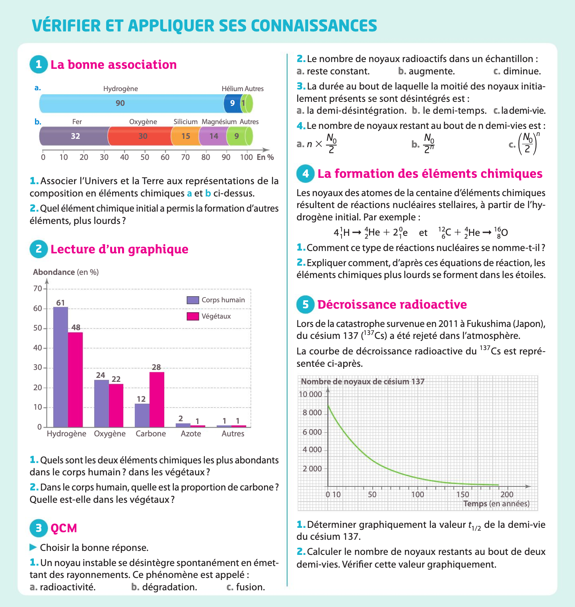
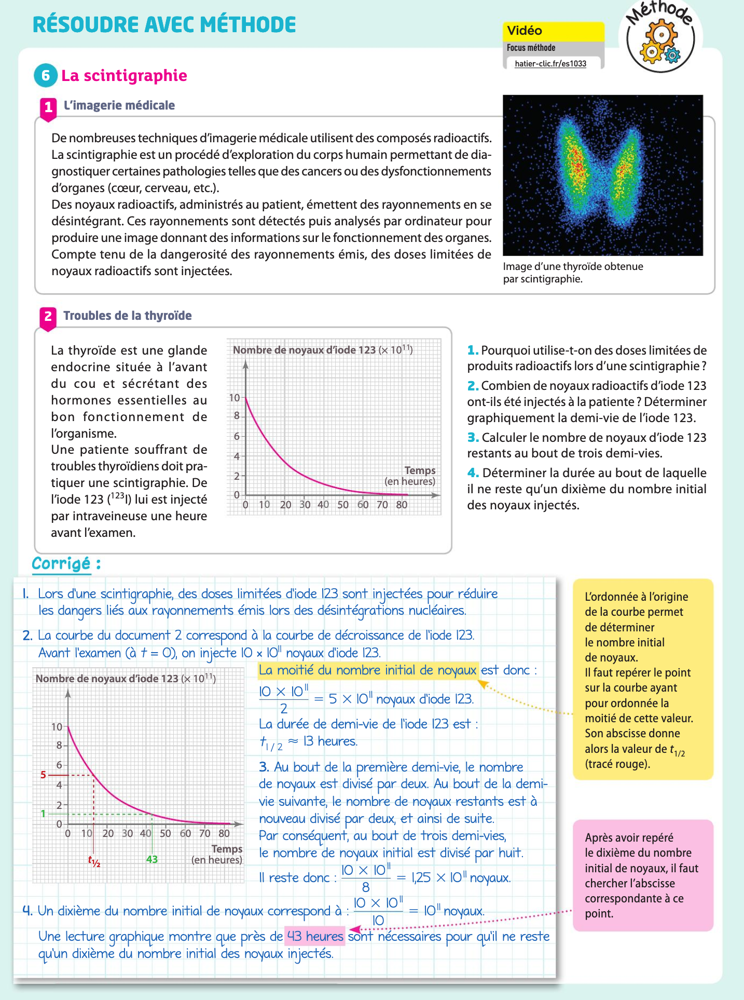
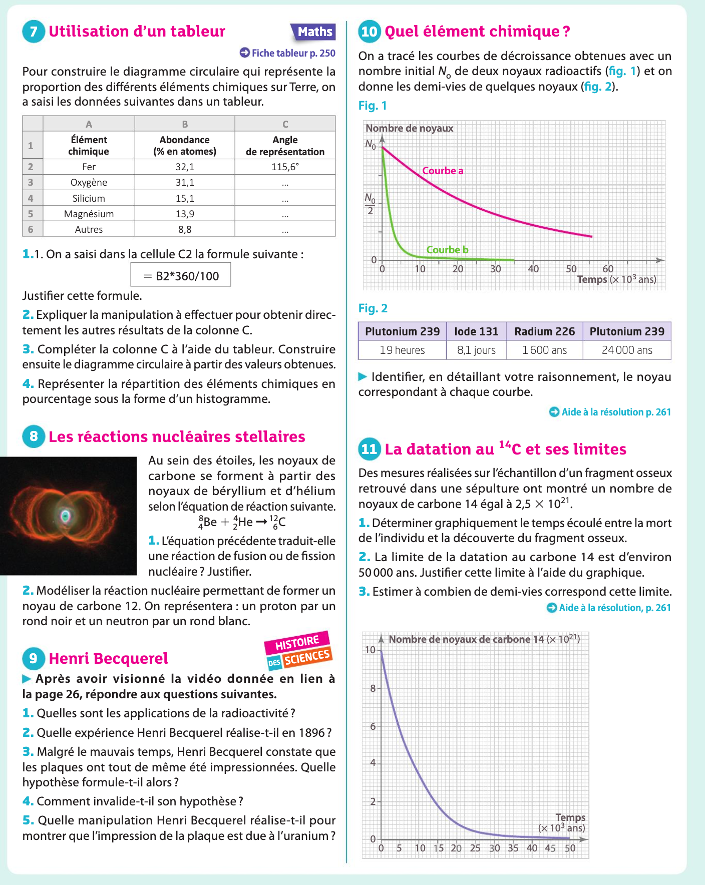
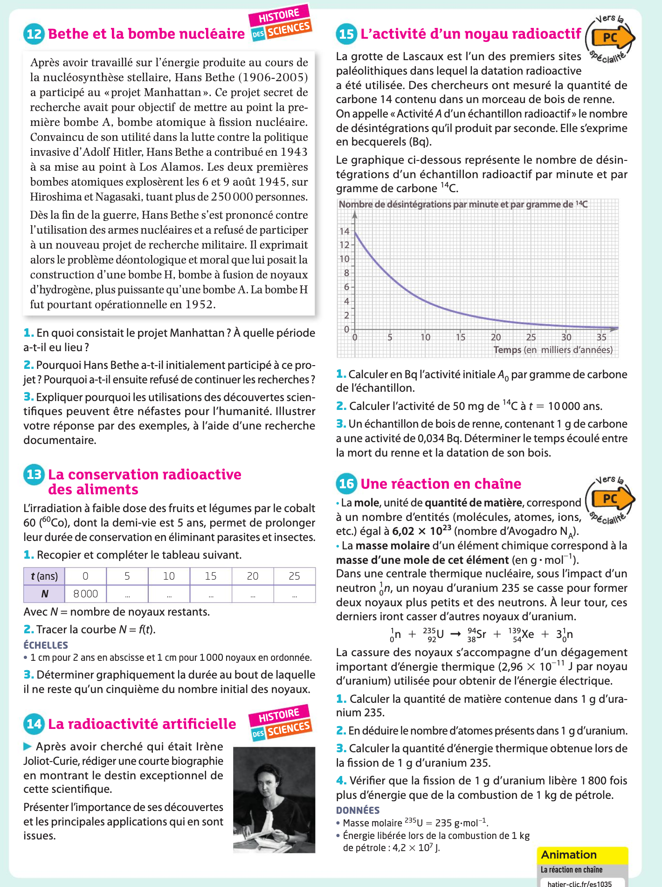
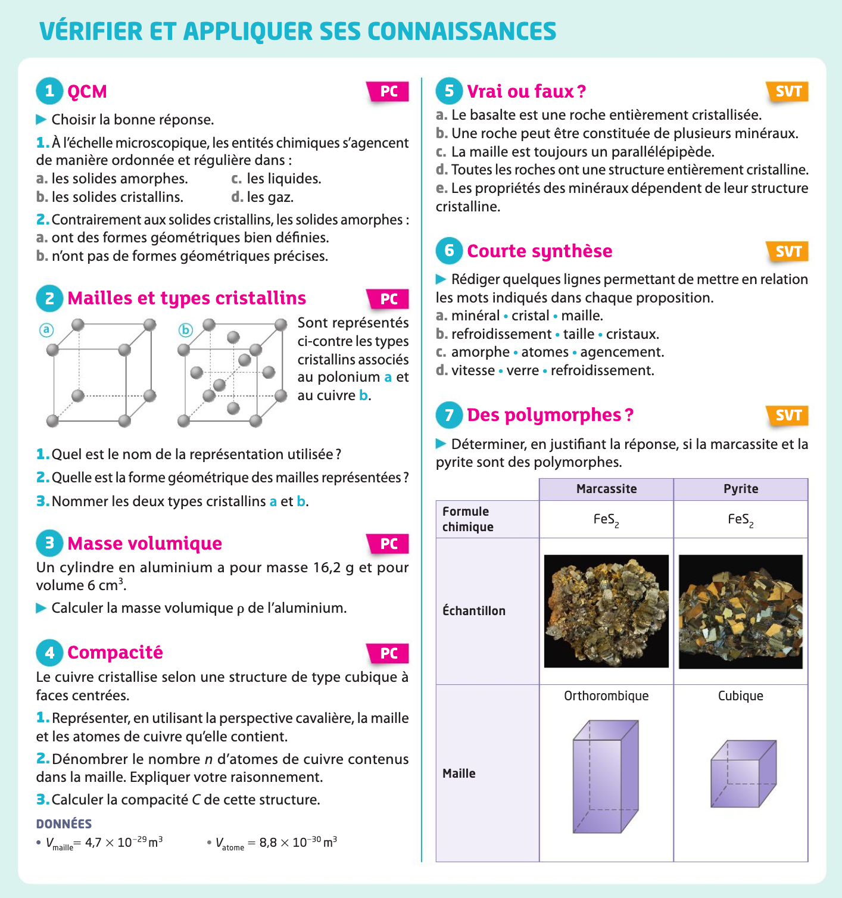
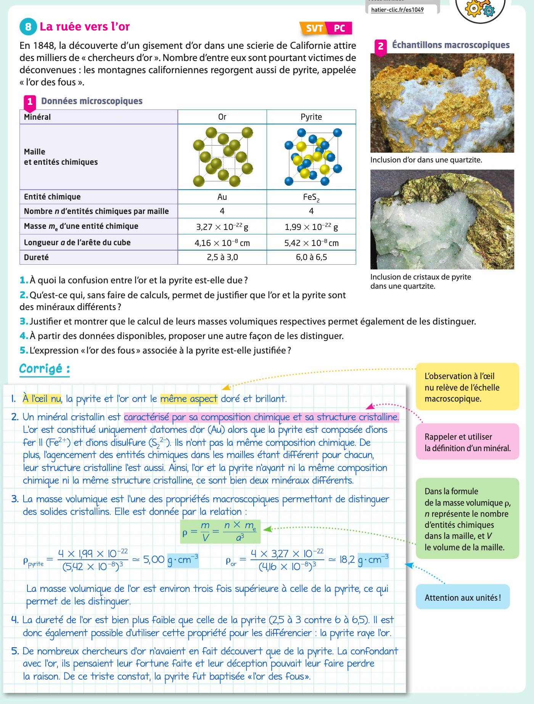
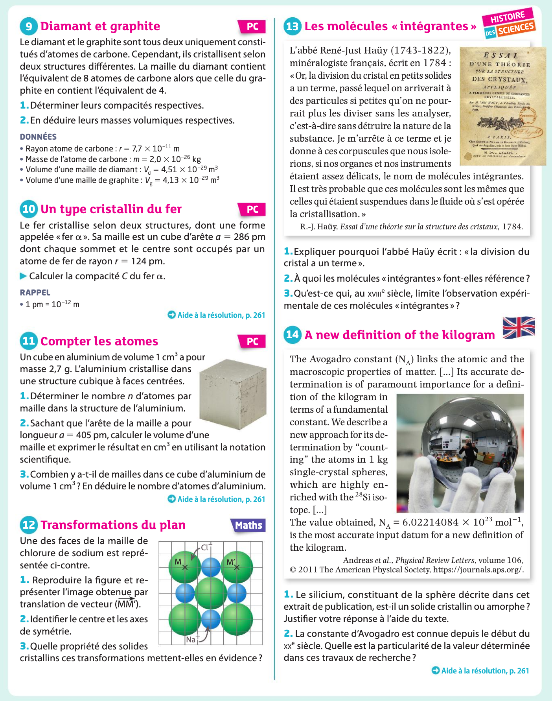
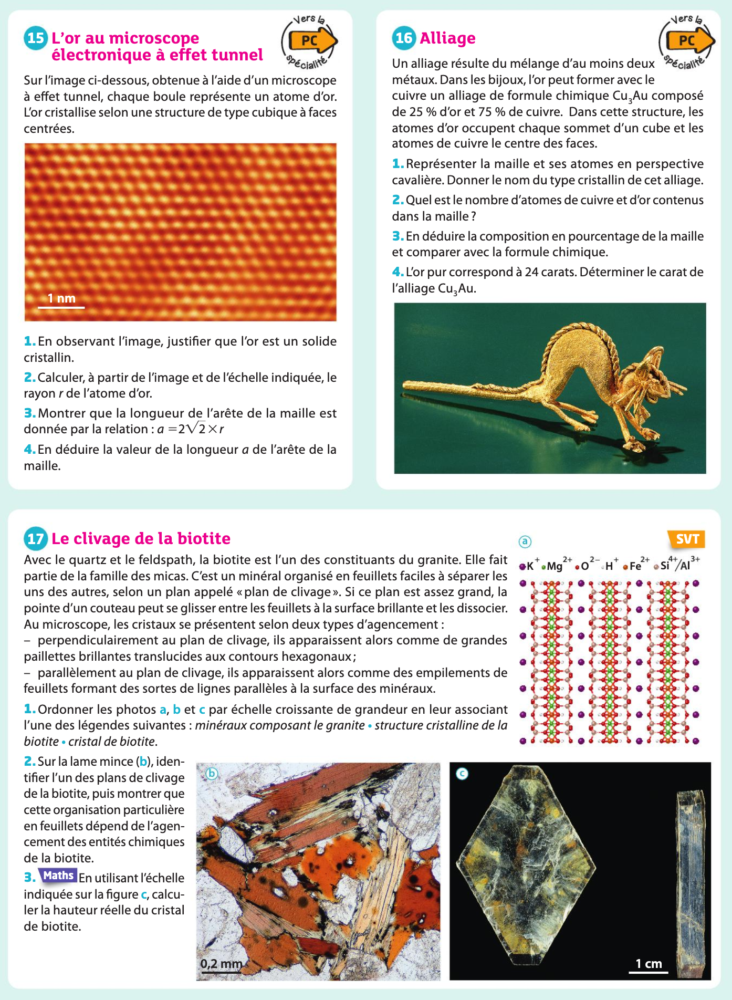

# Exercices

## Une longue histoire de la matière

### Les éléments chimiques

??? question "Exercices du Hatier (p.32 à p.35)"
    
    
    
        

### Les cristaux

??? question "Exercices du Hatier (p.48 à p.51)"
    
    
    
        
